## 1. Giới thiệu chung về Spark

Apache Spark là một hệ thống xử lý phân tán mã nguồn mở được thiết kế cho các bài toán dữ liệu lớn được phát triển bởi Apache Software Foundation.

Spark hỗ trợ đa ngôn ngữ lập trình (Java, Scala, Python, R) và nhiều loại workload như xử lý theo lô (batch-based), xử lý theo thời gian thực (streaming), học máy (machine learning) và xử lý đồ thị (graph processing), truy vấn SQL ...

Điểm nổi bật của Spark là thực thi tính toán trong bộ nhớ (in-memory) kết hợp với tối ưu hóa truy vấn, giúp xử lý dữ liệu nhanh hơn nhiều so với mô hình MapReduce truyền thống.
Do vậy, Spark đã trở thành công cụ quan trọng trong hệ sinh thái xử lý dữ liệu phân tán hiện đại.

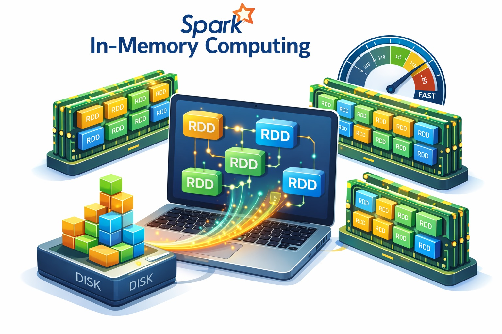

Spark có thể chạy trên nhiều hệ thống quản lý cụm khác nhau (cluster manager) như Hadoop YARN, Apache Mesos hoặc Spark Standalone Scheduler.
Spark cũng tích hợp tốt với HDFS và các nguồn lưu trữ phân tán khác.

## 2. Kiến trúc chung của Spark

### 2.1. Các thành phần trong Spark

Các thành phần trong Spark gồm:
- **Spark Core (API + Execution Engine):** lõi cung cấp API cơ bản và engine thực thi chịu trách nhiệm phân phối và thực thi công việc.
- **Thư viện chuẩn (Built-in libraries):** các thành phần cấp cao xây dựng trên lõi để cung cấp các khả năng xử lý dữ liệu chuyên biệt, bao gồm:
    - **Spark SQL:** xử lý dữ liệu có cấu trúc và bán cấu trúc, hỗ trợ truy vấn SQL.
    - **Spark Streaming:** xử lý dữ liệu luồng thời gian thực.
    - **MLlib:** thư viện học máy cung cấp các thuật toán và công cụ học máy.
    - **GraphX:** xử lý và phân tích dữ liệu đồ thị.
- **Hệ thống mở rộng (higher-level systems):** các thành phần phía trên lõi cung cấp khả năng xử lý chuyên biệt (ví dụ: thiết kế pipeline xử lý luồng).
    - **PySpark:** API chính thức cho Python
    - **SparkR:** API chính thức cho R
    - **Scala API:** API chính thức cho Scala
    - **Java API:** API chính thức cho Java

Hình dưới đây được lấy từ cuốn sách [Hadoop in practice - Second edition](https://github.com/MinhHuuNguyen/data-engineer-lectures/blob/master/books/hadoop_in_practice_second_edition_alex_holmes.pdf), mô tả các thành phần chính trong kiến trúc của Apache Spark.

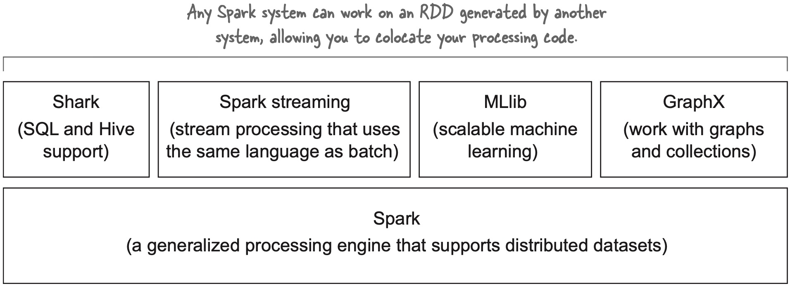

### 2.2. Kiến trúc của Spark

Cụm máy mà Spark sử dụng để thực thi các tác vụ được quản lý bởi một trình quản lý cụm.
Chúng ta gửi các Ứng dụng Spark (Spark Applications) tới những trình quản lý cụm này; các trình quản lý sẽ cấp tài nguyên cho ứng dụng của chúng ta để hoàn thành công việc.

Kiến trúc của Spark được chia làm ba thành phần chính:
- **Trình quản lý cụm (Cluster Manager):** Quản lý máy vật lý và tài nguyên (ví dụ: Spark Standalone, YARN, Mesos).
- **Ứng dụng Spark (Spark Application):** Gồm một driver và nhiều executor.
    - **Driver:** Chạy main(), duy trì trạng thái ứng dụng, nhận/đáp ứng đầu vào, phân tích và lập lịch công việc.
    - **Executor:** Thực thi mã do driver giao, lưu trữ và báo cáo trạng thái tính toán.

Hình dưới đây được lấy từ cuốn sách [Hadoop in practice - Second edition](https://github.com/MinhHuuNguyen/data-engineer-lectures/blob/master/books/hadoop_in_practice_second_edition_alex_holmes.pdf), mô tả kiến trúc của Apache Spark.

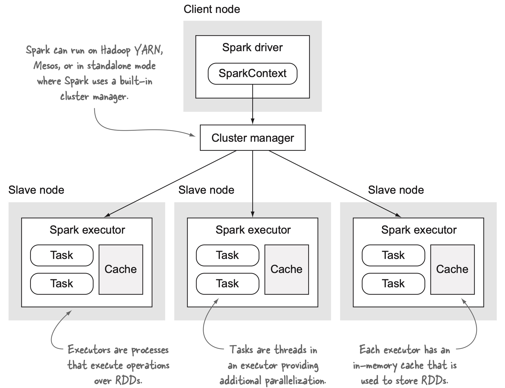

Spark hoạt động phân tách rõ ràng giữa thành phần điều phối (driver), thành phần thực thi (executors) và lớp quản lý tài nguyên (cluster manager), cho phép thực thi phân tán, linh hoạt và có thể chạy nhiều ứng dụng đồng thời trên cùng một cụm.

Tasks được lập lịch và phân phối bởi driver tới các executors, tận dụng tài nguyên được cấp phát bởi cluster manager.
Cache là bộ nhớ đệm phân tán trên các executors để lưu trữ dữ liệu tạm thời, giúp tăng tốc độ truy cập dữ liệu trong các tác vụ lặp lại.

Driver có thể được điều khiển từ nhiều ngôn ngữ thông qua các API (Scala/Java/Python/R), trong khi executors chịu trách nhiệm thực thi công việc.

### 2.3. Spark tương tác với YARN

Spark hỗ trợ nhiều trình quản lý cụm, trong đó có YARN.
Ở chế độ này, các executor của Spark là các container do YARN quản lý, và ApplicationMaster của Spark chịu trách nhiệm quản lý các executor đó và gửi lệnh cho chúng.

Hình dưới đây được lấy từ cuốn sách [Hadoop in practice - Second edition](https://github.com/MinhHuuNguyen/data-engineer-lectures/blob/master/books/hadoop_in_practice_second_edition_alex_holmes.pdf), mô tả cách Spark tương tác với YARN để quản lý tài nguyên và thực thi công việc.

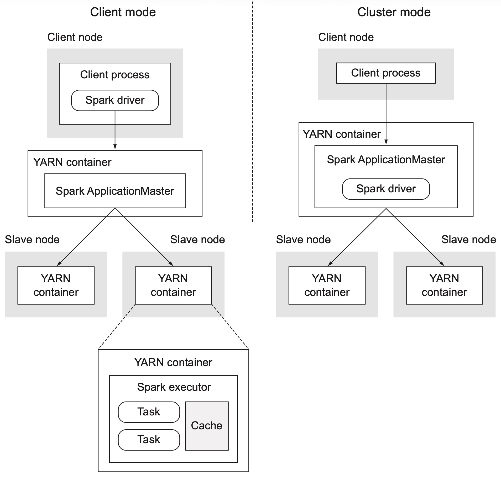

Driver của Spark có thể nằm trong tiến trình client hoặc bên trong ApplicationMaster, tùy thuộc vào việc bạn chạy ở client mode hay cluster mode:
- **Client mode:** driver nằm trong tiến trình client; do đó, nếu tiến trình client bị dừng thì việc thực thi chuỗi các tác vụ Spark sẽ bị gián đoạn.
Chế độ này phù hợp cho môi trường development với dữ liệu nhỏ, dùng trong quá trình debug, quan sát log và trạng thái driver dễ dàng.
- **Cluster mode:** driver chạy bên trong ApplicationMaster và không phụ thuộc vào tiến trình client để thực thi các tác vụ.
Chế độ này phù hợp cho môi trường production với dữ liệu lớn, giúp tăng tính ổn định và khả năng chịu lỗi.

Cài đặt mặc định của Spark được cấu hình cho chế độ standalone, nên bạn cần cấu hình Spark để nó hoạt động với YARN.
Các script và công cụ Spark không thay đổi khi chạy trên YARN; vì vậy một khi đã cấu hình để dùng YARN, bạn có thể chạy Spark shell giống như trước.

## 3. Thành phần cốt lõi Spark Core

Spark Core là “trái tim” của Spark, cung cấp nền tảng thực thi và các cơ chế cốt lõi cho mọi ứng dụng Spark.
Một số công nghệ quan trọng trong Spark Core bao gồm Kiểu dữ liệu RDD, Cơ chế đánh giá lười (Lazy evaluation) và Bộ tối ưu hóa Catalyst (Catalyst Optimizer).

### 3.1. Resilient Distributed Dataset (RDD)

Resilient Distributed Dataset (RDD) là cấu trúc dữ liệu quan trọng nhất trong Apache Spark, là tập hợp dữ liệu bất biến được phân tán trên các node của cụm, cho phép xử lý song song.
RDD là một khái niệm quan trọng trong Spark Core được sử dụng để lưu trữ và xử lý dữ liệu trên một cụm máy tính phân tán.

Hình dưới đây được lấy từ cuốn sách [Spark: The definitive Guide](https://github.com/MinhHuuNguyen/data-engineer-lectures/blob/master/books/spark_the_definitive_guide_bill_chambers_matei_zaharia.pdf), mô tả sự phân tán dữ liệu trên các server trong cụm Spark.

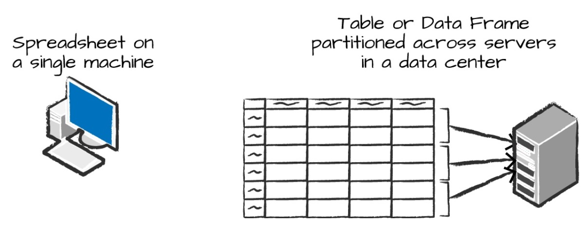

RDD chia dữ liệu thành các phần nhỏ và phân tán chúng trên các nút trong cụm, trong đó, mỗi phần dữ liệu được lưu trữ trên một nút và có thể xử lý một cách độc lập.

Ngoài ra, RDD có khả năng lưu trữ dữ liệu trong bộ nhớ RAM, giúp tối ưu hóa hiệu suất xử lý dữ liệu.
Khi dữ liệu đã được lưu trữ trong bộ nhớ, các phép tính toán sau này trên RDD có thể được thực hiện nhanh hơn vì không cần đọc dữ liệu từ đĩa.

Hình dưới đây được lấy từ cuốn sách [Spark: The definitive Guide](https://github.com/MinhHuuNguyen/data-engineer-lectures/blob/master/books/spark_the_definitive_guide_bill_chambers_matei_zaharia.pdf), mô tả sự so sánh giữa Narrow transformations và Wide transformations trong RDD.

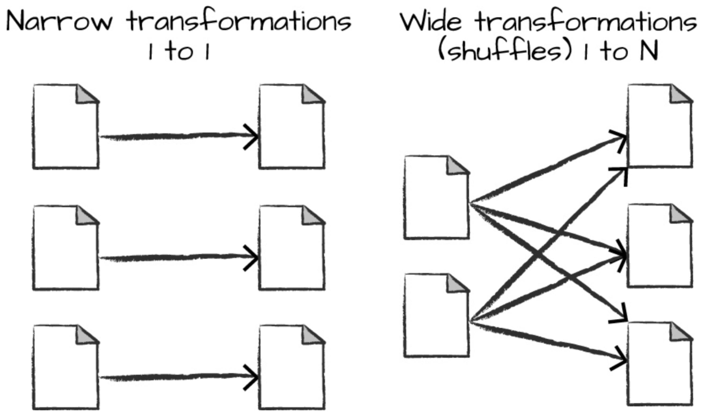

Có hai loại toán tử tương tác với RDD:
- **Transformation** là các toán tử trả đầu ra là một RDD mới sau khi thực hiện biến đổi RDD
    - **Narrow transformations**
        - Là các phép biến đổi mà mỗi phần tử đầu ra chỉ phụ thuộc vào một vài phần tử đầu vào và không cần truy cập đến tất cả các phần tử trong các phân vùng (partitions) của RDD.
        - Thực hiện song song trên từng phân vùng riêng lẻ mà không cần giao tiếp hoặc trao đổi dữ liệu giữa các phân vùng.
        Do đó, chúng có hiệu suất cao hơn và không yêu cầu nhiều bước tính toán phức tạp.
        - Ví dụ: select, map, filter ...
    - **Wide transformations**: Dữ liệu cần để thực hiện biến đổi nằm trên các partition khác nhau
        - Là các phép biến đổi mà mỗi phần tử đầu ra có thể phụ thuộc vào tất cả các phần tử trong các phân vùng của RDD hoặc có khả năng giao tiếp và trao đổi dữ liệu giữa các phân vùng.
        - Thường gây ra sự di chuyển dữ liệu giữa các phân vùng, đòi hỏi nhiều bước tính toán và có thể làm giảm hiệu suất
        - Ví dụ: groupBy, join, sort, ...
- **Action** là các toán tử trả đầu ra là các giá trị sau khi thực hiện tính toán trên RDD. Ví dụ: show, count, first, save, ...

### 3.2. Cơ chế Lazy evaluation

Lazy evaluation không phải là cơ chế được sáng tạo bởi nhà phát triển của Spark nhưng được ứng dụng vào RDD của Spark giúp tăng tốc hiệu quả xử lý dữ liệu lớn.

Có hai chiến lược đối nghịch nhau là Lazy Evaluation và Eager Evaluation:
- **Lazy Evaluation**:
    - Là một phương pháp trong đó biểu thức hoặc tính toán không được đánh giá ngay lập tức khi chúng được tạo ra.
    Thay vào đó, chúng được lưu trữ tạm thời và chỉ được tính toán khi cần thiết.
    - Giúp tối ưu hóa việc sử dụng tài nguyên bằng cách tránh tính toán không cần thiết.
    Nó đặc biệt hữu ích khi làm việc với dữ liệu lớn hoặc trong các tình huống cần tối ưu hóa hiệu suất.
- **Eager Evaluation**:
    - Là phương pháp trong đó biểu thức hoặc tính toán được đánh giá ngay lập tức khi chúng được tạo ra.
    Các giá trị kết quả được tính toán và lưu trữ ngay sau khi biểu thức được gọi.
    - Dễ dàng để hiểu và debug vì tất cả các biểu thức và tính toán đều được thực hiện ngay lập tức.
    - Có thể gây lãng phí tài nguyên và thời gian nếu các tính toán không cần thiết được thực hiện.

Ví dụ:
```python
# Ví dụ sử dụng Lazy Evaluation
def lazy_add(a, b):
    return lambda: a + b

result = lazy_add(3, 4)  # Không thực hiện phép cộng ngay lập tức
print("Biểu thức vẫn chưa được tính toán")
print("Kết quả sau khi tính toán:", result())  # Khi cần, biểu thức mới được tính toán
```

```python
# Ví dụ sử dụng Eager Evaluation
def eager_add(a, b):
    return a + b

result = eager_add(3, 4)  # Thực hiện phép cộng ngay lập tức
print("Biểu thức đã được tính toán")
print("Kết quả sau khi tính toán:", result)  # Kết quả đã được tính toán trước đó
```

Trong Spark, Lazy evaluation cho phép ta định nghĩa nhiều phép biến đổi dữ liệu (Transformation) trước khi chúng được thực sự tiến hành khi một hành động (Action) được gọi.
**Do đó, Transformations are LAZY but Actions are EAGER.**

Ví dụ: Ta có một RDD chứa dữ liệu của các học sinh trong một lớp học.
Ta muốn tính tổng điểm của tất cả các học sinh trong lớp.
Để làm điều này, ta có thể sử dụng phương pháp Eager Evaluation như sau:

```python
# Eager Evaluation
# Tính tổng điểm của tất cả các học sinh trong lớp
total_score = 0
for student in students:
    total_score += student.score
```

Tuy nhiên, nếu ta muốn tính tổng điểm của các học sinh có điểm trên 8, ta sẽ phải thực hiện lại vòng lặp trên như sau:

```python
# Eager Evaluation
# Tính tổng điểm của tất cả các học sinh có điểm trên 8 trong lớp
total_score = 0
for student in students:
    if student.score > 8:
        total_score += student.score
```

Để tránh việc thực hiện lại vòng lặp, ta có thể sử dụng phương pháp Lazy Evaluation như sau:

```python
# Lazy Evaluation
# Tính tổng điểm của tất cả các học sinh trong lớp
total_score = students.map(lambda student: student.score).reduce(lambda x, y: x + y)
```

```python
# Lazy Evaluation
# Tính tổng điểm của tất cả các học sinh có điểm trên 8 trong lớp
total_score = students.filter(lambda student: student.score > 8).map(lambda student: student.score).reduce(lambda x, y: x + y)
```

### 3.3. Catalyst Optimizer

Catalyst là một bộ tối ưu hóa được sử dụng để cải thiện hiệu suất và tối ưu hóa kế hoạch thực hiện các đoạn code logic xử lý dữ liệu.
Nó là một bộ tối ưu hóa dựa trên quy tắc (rule-based optimizer) và được sử dụng để biến đổi đoạn code logic xử lý dữ liệu tạo ra các kế hoạch thực hiện hiệu quả hơn.

Hình dưới đây được lấy từ cuốn sách [Spark: The definitive Guide](https://github.com/MinhHuuNguyen/data-engineer-lectures/blob/master/books/spark_the_definitive_guide_bill_chambers_matei_zaharia.pdf), mô tả ý tưởng của Catalyst Optimizer.

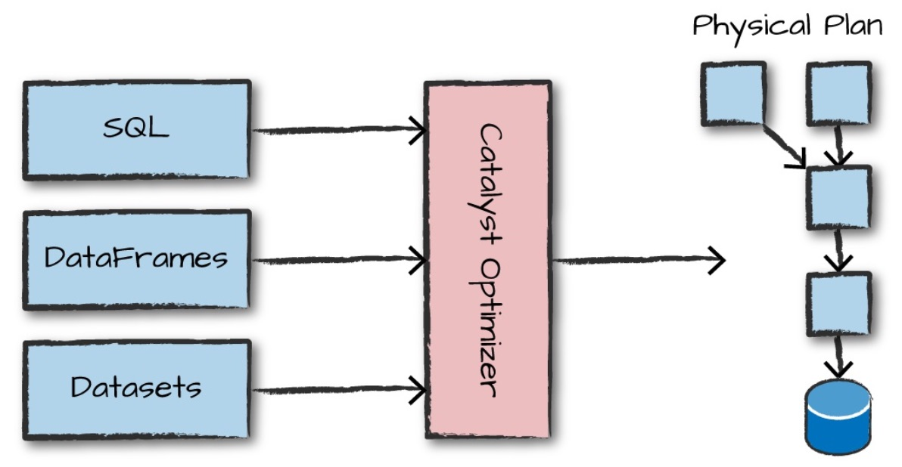

Quá trình tối ưu hóa trong Catalyst bao gồm hai giai đoạn chính: Logical Planning và Physical Planning.
Catalyst Optimizer chia quá trình xử lý thành hai tầng rõ ràng, giúp Spark đạt hiệu năng cao và linh hoạt.
- Logical planning tối ưu “cái gì cần làm”.
- Physical planning quyết định “làm như thế nào” trên cluster.

Đối với Logical Planning (lập kế hoạch logic):
- **Bước 1:** Spark chuyển mã người dùng thành **unresolved logical plan**.
Kế hoạch này được gọi là “chưa được phân giải” vì mặc dù mã có thể hợp lệ về mặt cú pháp, nhưng các bảng hoặc cột mà nó tham chiếu có thể tồn tại hoặc không tồn tại.
- **Bước 2:** Spark sử dụng **catalog** — kho lưu trữ thông tin về tất cả các bảng và DataFrame — để phân giải tên bảng và cột.
Ở đây, Spark có thể từ chối **unresolved logical plan** nếu bảng hoặc cột không tồn tại trong catalog.
Nếu có thể phân giải, kế hoạch sẽ được gọi là **logical plan** và chuyển sang Catalyst Optimizer.
- **Bước 3:** Catalyst áp dụng một loạt các quy tắc tối ưu hóa để biến đổi **logical plan** thành **optimized logical plan** như đẩy điều kiện lọc (predicate pushdown), sắp xếp lại các phép nối (join reordering), loại bỏ các cột dư thừa (projection pruning) và loại bỏ các bước trung gian không cần thiết.
Các gói mở rộng có thể bổ sung thêm luật tối ưu riêng cho những bài toán chuyên biệt.
- **Bước 4:** Kế hoạch logic tối ưu **optimized logical plan** sẽ được chuyển sang giai đoạn lập kế hoạch vật lý.

Hình dưới đây được lấy từ cuốn sách [Spark: The definitive Guide](https://github.com/MinhHuuNguyen/data-engineer-lectures/blob/master/books/spark_the_definitive_guide_bill_chambers_matei_zaharia.pdf), mô tả ý tưởng của Logical Plan trong Catalyst Optimizer.

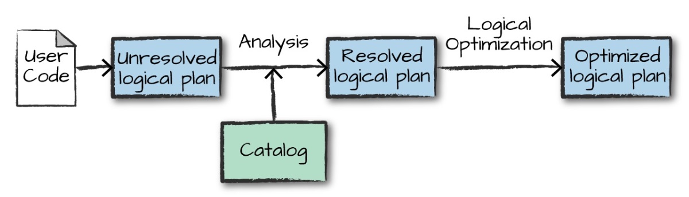

Physical plan (thường được gọi là Spark plan) mô tả cách **optimized logical plan** sẽ được thực thi trên cluster bằng cách sinh ra nhiều chiến lược thực thi vật lý khác nhau và so sánh chúng thông qua một mô hình chi phí (cost model).

Kết quả của physical planning là một chuỗi các RDD và các phép biến đổi tương ứng.
Đây là lý do Spark thường được xem như một “trình biên dịch”: nó nhận các truy vấn ở mức DataFrame, Dataset hoặc SQL và biên dịch chúng thành các phép biến đổi RDD.
Sau khi chọn physical plan, Spark thực thi mã này trên RDD — giao diện lập trình mức thấp của Spark.

Trong quá trình chạy, Spark tiếp tục thực hiện các tối ưu ở thời gian thực, sinh bytecode Java gốc có thể loại bỏ toàn bộ tác vụ hoặc stage không cần thiết.
Cuối cùng, kết quả được trả về cho người dùng.

Hình dưới đây được lấy từ cuốn sách [Spark: The definitive Guide](https://github.com/MinhHuuNguyen/data-engineer-lectures/blob/master/books/spark_the_definitive_guide_bill_chambers_matei_zaharia.pdf), mô tả ý tưởng của Physical Plan trong Catalyst Optimizer.

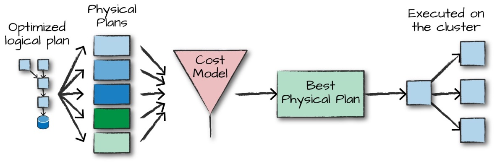

Ví dụ: Giả sử ta có một truy vấn SQL như sau:

```sql
SELECT c.customer_id, c.name, o.order_id, o.amount
FROM customers c
JOIN orders o
  ON c.customer_id = o.customer_id
WHERE o.amount > 100 AND c.country = 'US';
```

Kết quả tối ưu của câu truy vấn trên như sau:

```
Project [c.customer_id#10, c.name#11, o.order_id#20, o.amount#21]
+- Join Inner, (c.customer_id#10 = o.customer_id#22)
   :- Project [customer_id#10, name#11]
   :  +- Filter (country#12 = US)
   :     +- Relation customers [customer_id#10, name#11, country#12]   -- projection pruning
   +- Project [order_id#20, customer_id#22, amount#21]
      +- Filter (amount#21 > 100)
         +- Relation orders [order_id#20, customer_id#22, amount#21]  -- projection pruning
```

Những thay đổi chính so với kế hoạch đã phân giải:
- **Predicate pushdown:** c.country = 'US' được đẩy xuống phía customers relation; o.amount > 100 được đẩy xuống orders relation. Điều này giảm lượng dữ liệu truyền đến bước Join.
- **Projection pruning:** chỉ giữ các cột cần thiết (ví dụ signup_date, age, status, created_at bị loại khỏi scan).
- Catalyst optimizer có thể quyết định thứ tự join hoặc chọn thuật toán join phù hợp (thường xuất hiện ở physical planning).

## 4. Các thành phần cấp cao của Spark

### 4.1. SparkSQL

Spark SQL đóng vai trò là lớp xử lý dữ liệu có cấu trúc trong hệ sinh thái Spark.
Spark SQL có thể nạp dữ liệu từ nhiều nguồn dữ liệu có cấu trúc khác nhau (ví dụ: JSON, Hive và Parquet).

Spark SQL cho phép người dùng truy vấn dữ liệu bằng SQL, cả ở bên trong chương trình Spark lẫn từ các công cụ bên ngoài kết nối tới Spark SQL thông qua các chuẩn kết nối cơ sở dữ liệu (như Chuẩn kết nối cơ sở dữ liệu dành cho ngôn ngữ Java: Java Database Connectivity - JDBC hay Chuẩn kết nối cơ sở dữ liệu độc lập ngôn ngữ lập trình: Open Database Connectivity - ODBC).
Từ đó, các công cụ phân tích nghiệp vụ (Business Intelligence) như Tableau, QlikView và Power BI có thể kết nối trực tiếp tới Spark SQL để truy vấn và trực quan hóa dữ liệu.

Hình dưới đây được lấy từ cuốn sách [Learning Spark: LIGHTNING-FAST DATA ANALYSIS](https://github.com/MinhHuuNguyen/data-engineer-lectures/blob/master/books/learning_spark_lightning_fast_big_data_analysis_holden_karau_andy_konwinski_patrick_wendell_matei_zaharia.pdf), mô tả kiến trúc và luồng hoạt động cơ bản của Spark SQL.

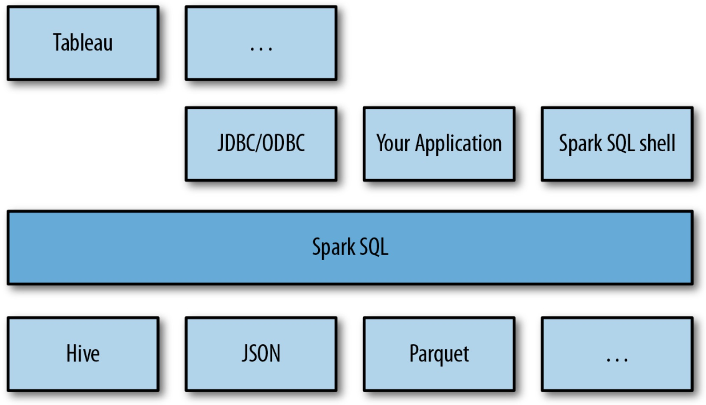

Khi được sử dụng bên trong một chương trình Spark, Spark SQL cung cấp khả năng tích hợp chặt chẽ giữa SQL và mã Python/Java/Scala, bao gồm việc cho phép join giữa RDD và các bảng SQL, định nghĩa và sử dụng các hàm tùy biến trong SQL, cùng nhiều khả năng mở rộng khác.
Nhiều tác vụ xử lý dữ liệu trở nên dễ triển khai hơn nhờ sự kết hợp này.

#### So sánh giữa Spark SQL và Hive

| Tiêu chí           | **Hive**                                   | **Spark SQL**                        |
| ------------------ | ------------------------------------------ | ------------------------------------ |
| Mục tiêu chính     | Data warehouse trên Hadoop                 | Xử lý dữ liệu có cấu trúc trên Spark |
| Engine thực thi    | MapReduce / Tez / Spark                    | Spark engine (in-memory)             |
| Hiệu năng          | Trung bình → thấp (đặc biệt với MapReduce) | Cao, độ trễ thấp                     |
| Độ trễ truy vấn    | Cao (phút)                                 | Thấp (giây)                          |
| Xử lý trong bộ nhớ | Không / hạn chế                            | Có                                   |
| Ngôn ngữ           | HiveQL                                     | SQL chuẩn + DataFrame/Dataset API    |
| Tích hợp với code  | Hạn chế                                    | Rất chặt chẽ (Python/Scala/Java)     |
| Quản lý metadata   | Hive Metastore                             | Thường dùng chung Hive Metastore     |
| Khả năng mở rộng   | Tốt cho batch lớn                          | Tốt cho batch và interactive         |
| Tính linh hoạt     | Thấp hơn                                   | Cao hơn                              |

- **Hive:** phù hợp cho lưu trữ và phân tích batch quy mô lớn, ít yêu cầu thời gian phản hồi.
- **Spark SQL:** phù hợp cho xử lý nhanh, tương tác, và phân tích nâng cao.

**Thực tế triển khai phổ biến: 👉 Hive Metastore + Spark SQL làm engine xử lý.**

#### So sánh giữa RDD, DataFrame, Dataset và Database/Metastore

| Tiêu chí           | **RDD**                       | **DataFrame**          | **Dataset**              | **Database / Metastore** |
| ------------------ | ----------------------------- | ---------------------- | ------------------------ | ------------------------ |
| Bản chất           | Tập dữ liệu phân tán mức thấp | Bảng dữ liệu có schema | DataFrame có type-safety | Lớp quản lý metadata     |
| Mức trừu tượng     | Thấp                          | Trung bình             | Trung bình–cao           | Cao                      |
| Schema             | Không                         | Có                     | Có                       | Quản lý schema           |
| Type-safety        | Có (Scala/Java)               | Không                  | Có (Scala/Java)          | Không áp dụng            |
| Catalyst Optimizer | Không                         | Có                     | Có                       | Không                    |
| API chính          | map, filter, reduce           | select, groupBy, SQL   | Typed ops + SQL          | SQL DDL, catalog         |
| Hiệu năng          | Thấp hơn                      | Cao                    | Cao                      | Không xử lý trực tiếp    |
| Mục đích sử dụng   | Xử lý tùy biến, low-level     | ETL, analytics, BI     | Pipeline typed (Scala)   | Quản lý bảng & schema    |
| Quan hệ với Spark  | Nền tảng xử lý                | Lớp xử lý chính        | Lớp xử lý nâng cao       | Hỗ trợ truy vấn          |

- **RDD:** kiểm soát thấp tầng, ít tối ưu
- **DataFrame:** bảng dữ liệu, hiệu năng cao
- **Dataset:** DataFrame + type-safety
- **Database:** nơi quản lý schema và bảng, không trực tiếp xử lý dữ liệu

### 4.2. Spark Streaming

Spark Streaming là một thành phần quan trọng của hệ sinh thái Apache Spark, được thiết kế để xử lý và phân tích dữ liệu trực tiếp (real-time data) với tốc độ và khả năng mở rộng cao.
Spark Streaming tích hợp chặt chẽ với Apache Spark, Spark Streaming có thể sử dụng API của Java và Scala ở bản Spark 1.1, và bổ sung thêm API cho Python (PySpark) và R (SparkR) ở các bản sau đó.

Spark Streaming xử lý dữ liệu trực tiếp từ nhiều nguồn như streaming data (logs, sự kiện, dữ liệu sensor), batch data, và hệ thống hàng đợi tin nhắn (message queues) như Apache Kafka.

Hình dưới đây được lấy từ cuốn sách [Learning Spark: LIGHTNING-FAST DATA ANALYSIS](https://github.com/MinhHuuNguyen/data-engineer-lectures/blob/master/books/learning_spark_lightning_fast_big_data_analysis_holden_karau_andy_konwinski_patrick_wendell_matei_zaharia.pdf), mô tả ý tưởng của Spark Streaming.

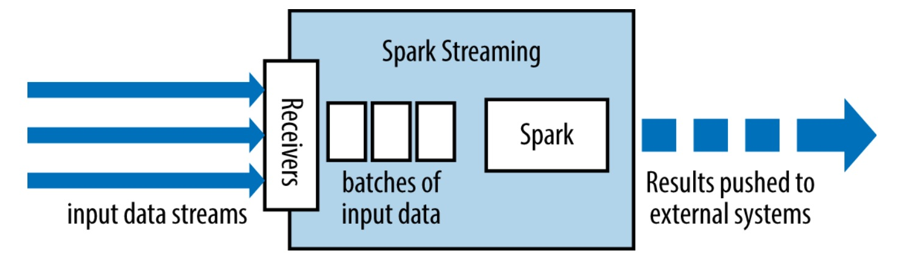

Spark Streaming không xử lý từng bản ghi (record) riêng lẻ, mà xử lý dữ liệu theo các lô nhỏ (micro-batch).
Spark Streaming sử dụng kiến trúc “micro-batch”, trong đó việc xử lý dữ liệu luồng được xem như một chuỗi liên tục các phép xử lý theo lô (batch) trên những tập dữ liệu nhỏ.
Spark Streaming nhận dữ liệu từ nhiều nguồn đầu vào khác nhau và gom chúng thành các lô nhỏ. Các lô mới được tạo ra theo những khoảng thời gian đều đặn.

Mỗi batch tương ứng với một RDD, và được xử lý bằng các phép biến đổi của Spark giống như xử lý batch truyền thống.
Việc xử lý diễn ra tuần tự theo từng batch, tạo thành một chuỗi các Spark job liên tiếp.
Kết quả xử lý được xuất ra các hệ thống lưu trữ hoặc dịch vụ bên ngoài theo từng batch.

Bản chất, Spark Streaming biến bài toán xử lý dữ liệu thời gian thực thành bài toán xử lý batch liên tục với độ trễ thấp (near real-time) tận dụng trực tiếp mô hình và engine xử lý của Spark Core.

### 4.3. Spark MLlib

Apache Spark MLlib (Machine Learning Library) là một thư viện machine learning mã nguồn mở và phân tán được tích hợp chặt chẽ với Apache Spark.
MLlib cung cấp một loạt các mô hình machine learning và công cụ cho việc xây dựng, đào tạo và triển khai mô hình học máy trên dữ liệu lớn.

Hình dưới đây được lấy từ cuốn sách [Learning Spark: LIGHTNING-FAST DATA ANALYSIS](https://github.com/MinhHuuNguyen/data-engineer-lectures/blob/master/books/learning_spark_lightning_fast_big_data_analysis_holden_karau_andy_konwinski_patrick_wendell_matei_zaharia.pdf), mô tả luồng hoạt động cơ bản của Machine Learning.

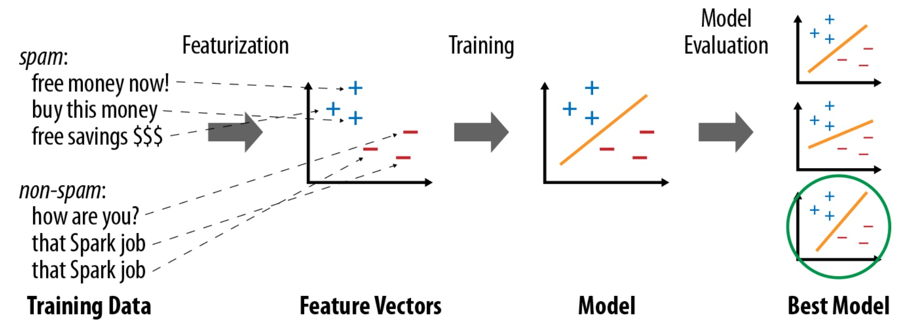

Spark MLlib tích hợp chặt chẽ với Apache Spark, cho phép sử dụng ngôn ngữ Scala, Java, Python hoặc R để làm việc với dữ liệu và thực hiện machine learning trên cụm Spark.
Điều này mang lại sự mạnh mẽ và khả năng mở rộng của Spark cho việc xử lý dữ liệu lớn.

Spark MLlib cung cấp một loạt các mô hình machine learning khác nhau bao gồm cả machine learning cổ điển và deep learning như: classification, regression, clustering.
Các mô hình này đã được tối ưu hóa để hoạt động trên cụm và xử lý dữ liệu phân tán.

Ngoài ra, Spark MLlib cung cấp các công cụ và tính năng liên quan đến machine learning như model evaluation, data pipeline, model pipeline.

### 4.4. Spark GraphX

Spark GraphX là một thư viện mã nguồn mở trong hệ sinh thái Apache Spark, được thiết kế để xử lý và phân tích dữ liệu đồ thị.
Thư viện này cung cấp các cấu trúc dữ liệu và các thuật toán đồ thị để giúp bạn nghiên cứu, phân tích mạng xã hội, xử lý dữ liệu đồ thị trong lĩnh vực khai thác dữ liệu và học máy.

Hình dưới đây được lấy từ cuốn sách [Spark: The definitive Guide](https://github.com/MinhHuuNguyen/data-engineer-lectures/blob/master/books/spark_the_definitive_guide_bill_chambers_matei_zaharia.pdf), mô tả một đồ thị.

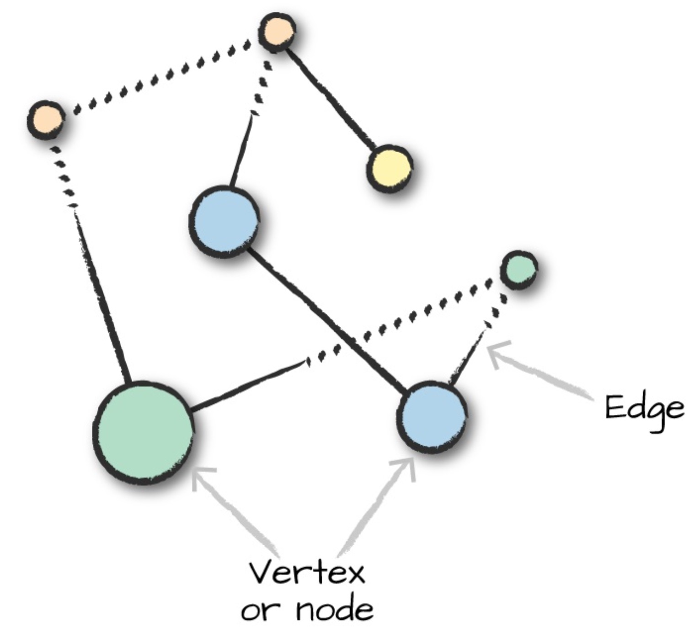

Spark GraphX xử lý dữ liệu đồ thị, trong đó các đỉnh và cạnh của đồ thị có thể đại diện cho các thực thể và mối quan hệ giữa chúng.
Điều này phù hợp cho việc nghiên cứu các mạng xã hội, mạng lưới, mạng thông tin, và nhiều ứng dụng khác.

Spark GraphX cung cấp cấu trúc dữ liệu linh hoạt để biểu diễn dữ liệu đồ thị, bao gồm đồ thị hướng và đồ thị không hướng.
Điều này cho phép bạn biểu diễn một loạt các dữ liệu đồ thị phức tạp.

Spark GraphX cung cấp một loạt các thuật toán đồ thị như duyệt đồ thị (graph traversal), tính toán đường đi ngắn nhất (shortest path), tìm kiếm đồ thị (graph search), tính toán bậc và thuật toán phân cụm (clustering algorithms) để phân tích và khám phá thông tin từ dữ liệu đồ thị.

### 4.5. Các API trên các ngôn ngữ lập trình

Các API đa ngôn ngữ của Spark cho phép nhiều nhóm người dùng khác nhau (kỹ sư hệ thống, data engineer, data scientist, nhà phân tích) khai thác cùng một engine xử lý phân tán, với mức độ trừu tượng và độ phức tạp phù hợp.

| Ngôn ngữ    | Vai trò chính                                         | Đặc điểm nổi bật                                           | Đối tượng / Trường hợp sử dụng                        |
| ----------- | ----------------------------------------------------- | ---------------------------------------------------------- | ----------------------------------------------------- |
| **Scala**   | API gốc, đầy đủ nhất của Spark                        | Hiệu năng cao, hỗ trợ toàn bộ tính năng Spark              | Phát triển hệ thống Spark lõi, ứng dụng hiệu năng cao |
| **Java**    | Cung cấp khả năng sử dụng Spark trong môi trường Java | Ổn định, tương thích tốt với hệ sinh thái doanh nghiệp     | Ứng dụng doanh nghiệp, hệ thống legacy                |
| **PySpark** | Đơn giản hóa việc sử dụng Spark cho phân tích dữ liệu | Cú pháp ngắn gọn, dễ học, phổ biến trong Data Science & ML | Phân tích dữ liệu và machine learning                 |
| **SparkR**  | Hỗ trợ phân tích thống kê trên dữ liệu lớn            | Tích hợp với hệ sinh thái R                                | Phân tích thống kê, nghiên cứu                        |

#### So sánh giữa Spark Context và Spark Session

Hình dưới đây được lấy từ cuốn sách [Spark: The definitive Guide](https://github.com/MinhHuuNguyen/data-engineer-lectures/blob/master/books/spark_the_definitive_guide_bill_chambers_matei_zaharia.pdf), mô tả cách tạo Spark Session trong Spark.

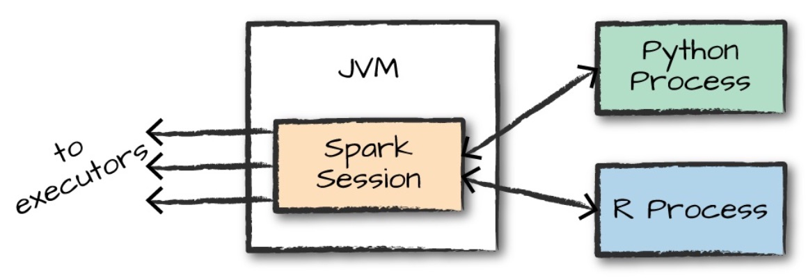

Spark Context (SC) là điểm khởi đầu để tương tác với Spark.
Nó chịu trách nhiệm thiết lập kết nối với cụm Spark, quản lý tài nguyên và cung cấp các phương thức để tạo RDD và thực thi các tác vụ phân tán.
Spark Context là thành phần cốt lõi trong các phiên bản Spark trước 2.0.

Spark Session (SS) được giới thiệu từ Spark 2.0 như một lớp trừu tượng cao hơn, cung cấp một giao diện thống nhất để làm việc với dữ liệu có cấu trúc và không cấu trúc, bao gồm cả DataFrame và Dataset.
Spark Session đơn giản hóa việc cấu hình và quản lý các thành phần Spark.

| Khía cạnh         | SparkContext                                                | SparkSession                                                              |
| ----------------- | ----------------------------------------------------------- | ------------------------------------------------------------------------- |
| Mục đích          | Kết nối cluster, thao tác RDD, cấu hình executor            | Entry point thống nhất cho DataFrame/Dataset/SQL và truy cập SparkContext |
| Ra đời/phiên bản  | Có từ đầu (Spark core)                                      | Từ Spark 2.0 trở đi                                                       |
| Thao tác chính    | RDD, low-level API, submit job                              | Read/Write (DataFrame), SQL, Catalog, cấu hình session                    |
| Tạo/khởi tạo      | `new SparkContext(conf)` (thấp cấp)                         | `SparkSession.builder().appName(...).getOrCreate()`                       |
| Khi nên dùng      | Khi cần thao tác RDD trực tiếp hoặc config cluster cấp thấp | Hầu hết trường hợp hiện đại — tạo DataFrame, truy vấn SQL, ML, Streaming  |

Đối với ứng dụng hiện đại dùng DataFrame/Dataset/SQL: dùng SparkSession làm entry point.
Nếu cần thao tác RDD thấp cấp hoặc cấu hình chi tiết ở mức core: vẫn có thể sử dụng spark.sparkContext.
